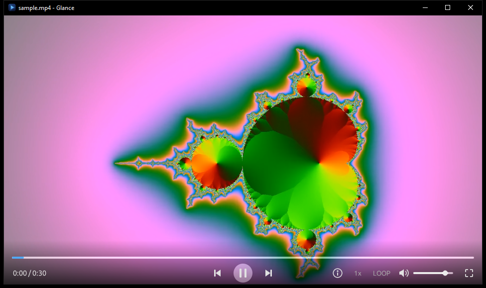

# Glance


A lightweight, quick-starting video player for Windows, written in Rust. Made to
replace the Windows default player: it opens in well under a second, plays almost
any video file, and keeps out of the way with a minimal overlay that hides while you watch.



## Download

Get **`Glance-<version>-windows-x64.zip`** from the [Releases page](https://github.com/TheSnapped/Glance/releases/latest),
unzip it somewhere permanent (for example `C:\Tools\Glance`) and run `glance.exe`.
Nothing is installed and no admin rights are needed. Requires Windows 10/11 (64-bit).

### Make it your default video player

Click **Set as default player** in Glance (or press `#` for Settings, or run
`glance.exe --register`). Windows then opens **Settings > Default apps**: click
**Video player** and choose **Glance**. Windows doesn't let apps make themselves the
default, so this click is needed. `glance.exe --unregister` undoes the registration.

## Features

- Plays H.264, HEVC, VP9, AV1, MPEG-2/4 and more, in MP4, MKV, WebM, AVI, MOV, TS, ...
- Timeline with preview thumbnails on hover
- Previous / next video in the same folder
- Speed 0.25x–3x with pitch kept, loop, resume where you left off
- Media info panel (codecs, resolution, frame rate, bitrate, tags)
- Settings for timeline colours, seek/volume steps, end-of-video behaviour and more
- "Open in Kerf" button that hands the video to the [Kerf](https://github.com/TheSnapped/Kerf) editor at the current moment

## Controls

| Action | Keys / mouse |
|---|---|
| Play / pause | Space, K, click the video or the centre button |
| Seek | Left/Right (step set in Settings), Ctrl+Left/Right = 6 steps, Home = start, drag the timeline |
| Preview | Hover the timeline to see a thumbnail of that moment |
| Volume | Up/Down, mouse wheel, M = mute |
| Previous / next video in folder | PageUp/PageDown, P/N |
| Fullscreen | F, F11, Enter, double-click; Esc leaves |
| Speed (0.25x-3x, pitch kept) | `+`/`-` or `]`/`[`, Backspace = 1x; click the speed label |
| Loop | L, or click LOOP |
| Media info | I, or the (i) button |
| Settings | # |
| Open in Kerf at the current moment (once linked in Settings) | E, or the Kerf button |
| Elapsed / remaining time | click the time |
| Open file | Ctrl+O |

Settings are stored in `%APPDATA%\Glance\settings.ini`, resume positions in `positions.txt` next to it.

## How it works

FFmpeg decodes on a background thread, OpenGL draws the frames (YUV to RGB conversion
runs in a shader), and the audio device is the master clock. A second, independent
FFmpeg context decodes the timeline thumbnails. The UI is [egui](https://github.com/emilk/egui).

## Building

Needs:
- Rust (MSVC toolchain)
- LLVM, for libclang, which the FFmpeg bindings need: `winget install LLVM.LLVM`
- The shared LGPL FFmpeg 9.0 build `ffmpeg-n9.0-latest-win64-lgpl-shared-9.0.zip` from
  [BtbN/FFmpeg-Builds](https://github.com/BtbN/FFmpeg-Builds/releases), unpacked into `third_party\`
  (the paths are set in `.cargo\config.toml`)

```
.\build.ps1      # builds dist\ (glance.exe + FFmpeg DLLs)
.\package.ps1    # builds, then zips ..\releases\Glance-<version>-windows-x64.zip
cargo run -- <video>
```

`build.rs` copies the DLLs next to the exe so `cargo run` works. `RELEASE-README.txt`
becomes the README inside the release zip. The icon is generated by `python assets/make_icon.py`.

Tests that play real files: `$env:GLANCE_SAMPLE="<video>"; cargo test --release -- --ignored --nocapture`.

## Made with AI

Glance was built with the help of AI: the code was written together with Claude (Anthropic)
in Claude Code, directed, tested and reviewed by me.

## License

Glance is licensed under the [GNU General Public License v3.0 or later](LICENSE).

Release builds include FFmpeg (https://ffmpeg.org) as unmodified DLLs from the
"n9.0 lgpl-shared" build of [BtbN/FFmpeg-Builds](https://github.com/BtbN/FFmpeg-Builds),
licensed under the GNU LGPL; see `FFMPEG-LICENSE.txt` in the release zip.
